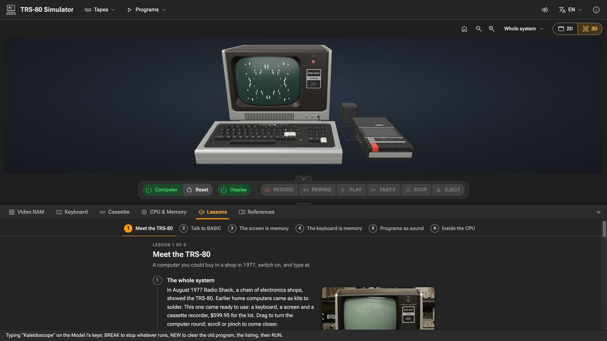
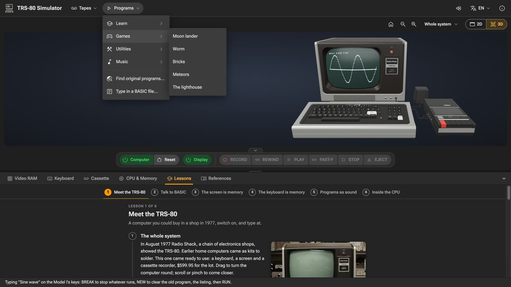
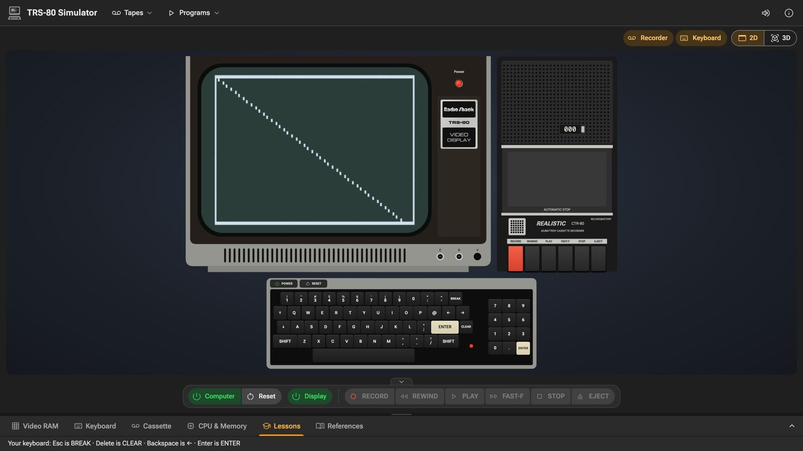
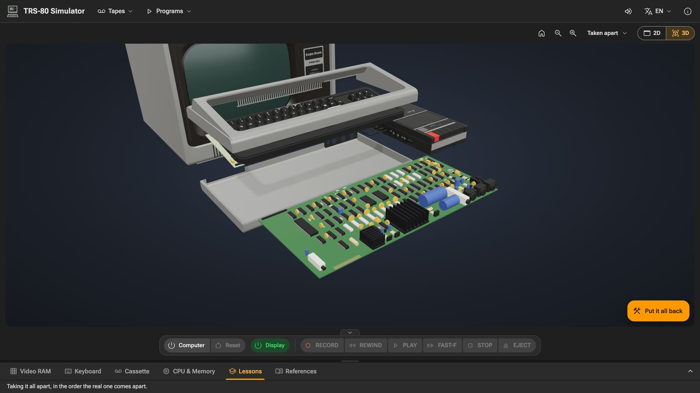

<p align="center"></p>

# TRS-80 Simulator

[](https://github.com/wixette/trs-80-simulator/actions/workflows/test.yml)

**The TRS-80 Model I of 1977, in 3D, in your browser.** Switch it on, type in BASIC, play games of the time, load programs from tape, and open it up to see how a computer works.

**[▶ Try it online](https://wixette.github.io/trs-80-simulator/)**: nothing to install, on a computer or a phone, in ten languages.



## What was the TRS-80?

In August 1977, Radio Shack, a chain of American electronics shops, introduced the **TRS-80**. Earlier home computers came as kits you soldered together and programmed with switches. This one came ready to use, out of a box, for $599.95: a keyboard with the computer inside it, a black-and-white screen, and a cassette recorder to keep programs on. With the Apple II and the Commodore PET of the same year, it began the age of the home computer.

Switched on, it asked one question, `MEMORY SIZE?`, then said `READY` and waited for you to type. What you typed was **BASIC**, a simple programming language kept in the computer's own memory chips. People typed in programs printed in magazines, played games, saved their work onto ordinary audio tape, and learned how computers work along the way.

This simulator is that machine, part for part: the same Z80 processor at the same speed, the same BASIC (Level II, 1978), the same screen, keyboard and tape, all running in your browser.

## Your first five minutes

1. **Open the simulator.** The machine is already on and asks `MEMORY SIZE?`.
2. **Press Enter** to answer it. The screen says `READY`.
3. **Type** `PRINT "HELLO"` and press Enter. The computer answers.
4. **Play something:** open **Programs** in the top bar, choose **Games**, then **Moon lander**, and **Type it in**. Watch the keys type it for you, then follow the screen.
5. **Learn:** the **Lessons** tab below the machine has six short lessons. Each step can type for you, and ticks itself when the machine shows it done.

**Your keyboard is the Model I's.** Enter is ENTER, Esc is BREAK (it stops a running program), the arrow keys are the arrows, and Delete or Home is CLEAR. The Model I has only capital letters, so whatever you type comes out in capitals. On a phone, switch to **2D** (top right): the screen at full size, with the keyboard to tap under it.

## What you can do

<table>
<tr>
<td colspan="2"><b>Run programs</b><br>21 of our own, typed in for you on the Model I's keys or loaded from tape: games, utilities and music in the style of 1977–80, and short ones to learn from.<br></td>
</tr>
<tr>
<td width="50%"><b>Switch to 2D</b><br>The machine's own faces, flat: the screen, the recorder, the keyboard. On a phone, this is where you type.<br></td>
<td width="50%"><b>Look inside while it runs</b><br>The case turns to glass; the board's chips light up as they work.<br></td>
</tr>
<tr>
<td><b>Take it apart</b><br>With the power off, in the order the real one comes apart.<br></td>
<td><b>See the screen as memory</b><br>1,024 bytes, live; pick one to see its bits become dots.<br></td>
</tr>
<tr>
<td><b>Save and load programs on tape</b><br>The tape under the head, as pulses, bits and bytes.<br></td>
<td><b>Watch the CPU work</b><br>Registers, the next instructions and memory, a step at a time.<br></td>
</tr>
</table>

### Programs

Open **Programs** in the top bar. Each program opens a page that says what it does and shows its listing, then offers two ways in: **Type it in**, as an owner typed a listing from a magazine, or **Put its tape in**, then PLAY and `CLOAD`.

- **Learn:** Hello, Guess my number, Sine wave, Kaleidoscope, Bouncing block, Sketch with the arrows, Notes to tape, BASIC against machine code.
- **Games:** Moon lander, Worm, Bricks, Meteors, and The lighthouse, a text adventure.
- **Utilities:** Clock, Calendar, Biorhythm, Banner.
- **Music:** Music box, Organ.

The Model I has no speaker. Owners plugged its cassette lead into an amplifier to hear their games and music, and the simulator does the same (the speaker button in the top bar turns it off).

**The era's own software** is not hosted here, as its rights are unclear, but much of it runs here. **Programs ▸ Find original programs** says where it is archived and how to load it: Model I cassette programs as `.cas` or `.wav` files, opened from **Tapes**. A program printed in a magazine goes in with **Programs ▸ Type in a BASIC file**.

### The lessons

Six lessons for a middle-school class or a first course in computer science. Each takes about one class period.

1. **Meet the TRS-80:** a computer you could buy in a shop in 1977, and its parts.
2. **Talk to BASIC:** `PRINT`, a first program, a loop, `INPUT`, and a whole game.
3. **The screen is memory:** a letter is a byte; draw with `SET`, then find the picture in memory.
4. **The keyboard is memory:** keys are switches in rows, read as bytes.
5. **Programs as sound:** save a program to tape, see its bits, load it back; data on tape, and music.
6. **Inside the CPU:** machine code put in with `POKE`, then stepped through one instruction at a time.

Each step has **Type it** (it types for you on the Model I's keys) and **Show me** (it points at what the step is about), and *Going further* asides for older students. Teachers will find timings, talking points and the questions students ask in the [teacher notes](lessons/teacher-notes.md) (in English).

### In ten languages

English, Español, Français, Deutsch, Italiano, Português (Brasil), 简体中文, 繁體中文, 日本語 and 한국어, the lessons included: choose one with the language button in the top bar. The machine's own words (BREAK, `READY`, BASIC itself) stay as the machine has them.

---

## For developers

Everything below is for people who want to run, change or check the simulator itself.

### Run it locally

There is nothing to build. Serve the folder over HTTP:

```
git clone https://github.com/wixette/trs-80-simulator.git
cd trs-80-simulator
python3 -m http.server 8000
```

Then open <http://localhost:8000/>.

### Check it

With Node.js and pnpm:

```
pnpm install
pnpm check            # the unit tests, the strict type check and the reference check (what CI runs)
pnpm test:browser     # the page itself in a headless Chrome: clicks, keys, menus, views, layout
```

The unit tests run the real Level II ROM on the emulated Z80: every lesson end to end, and every one of our programs loaded from its tape and played. The Z80 core also passes ZEXDOC (`pnpm test:zexdoc`).

### Tools

- `pnpm shots` and `pnpm video`: screenshots and short clips for the README and for posts, in any of the ten languages.
- `pnpm tapes`: records our programs' tapes into `tapes/`.
- `node tools/basic.mjs prog.bas`: runs a BASIC listing on the headless Model I, with keys pressed at given times, and prints the screen and the notes it played.

How the simulator is checked, built and released is in [docs/development.md](docs/development.md). More:
- the rules the code follows: [docs/conventions.md](docs/conventions.md);
- the page's design: [docs/ui-design.md](docs/ui-design.md);
- the machine's decisions: [design/decisions.md](design/decisions.md), and the plan: [design/roadmap.md](design/roadmap.md);
- the 3D model: [model/README.md](model/README.md);
- the machine's sources: [research/](research/).

### How it is made

- **The machine:** a Z80 core (`Z80.js`) with Level II BASIC 1.2 in ROM, 16 KB of RAM, the video RAM and its character generator, the keyboard matrix, and the cassette port, timed to the T-state at 1.774 MHz (`js/sim/`).
- **The 3D model:** built from measured parameters and the boards' netlists by Blender scripts, in `model/`, drawn with three.js (`js/scene/`).
- **The page:** plain JavaScript modules, no framework and no build step, type-checked with TypeScript's checker (`js/app/`, `js/ui/`).

## Licences

- The simulator's code is under the [Apache License 2.0](LICENSE).
- The 3D model, the lessons, the docs and the research notes are under [CC BY-SA 4.0](LICENSES/CC-BY-SA-4.0.txt).
- **Level II BASIC** in `roms/` is not ours: its copyright is Microsoft's and Tandy's. It is carried as a historical artifact, as other open emulators carry it. [roms/NOTICE](roms/NOTICE) says where it came from, and offers to remove it on request.
- Third-party material keeps its own licence: the Z80 core (MIT), xtrs's character set, three.js (MIT), the fonts (OFL 1.1), the icons (Apache-2.0) and the photographs. Each is listed in [docs/licensing.md](docs/licensing.md) and declared per file in `REUSE.toml`.

"TRS-80" names the machine simulated. This project is not affiliated with Tandy Corporation or RadioShack.

## Credits

- **RetroStack**'s reconstructions of the Model I: the boards, the case and *The TRS-80 Model I, as established*, a netlist-checked reference that the machine and the model are built from.
- **Lawrence Kesteloot**'s TRS-80 emulator, the reference for reading real tapes, and the second source for the ROM.
- **Matthew Reed**'s [TRS-80.org](https://www.trs-80.org/), for the history.
- **Molly Howell**'s `Z80.js`.
- **Tim Mann**'s xtrs, for the character set.
- The photographers credited in [images/photos/CREDITS.md](images/photos/CREDITS.md).
