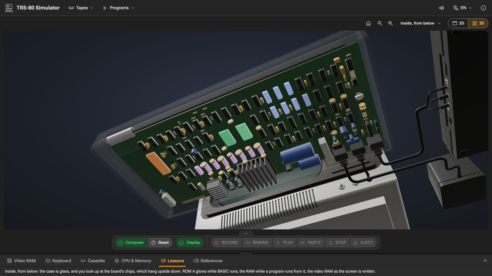
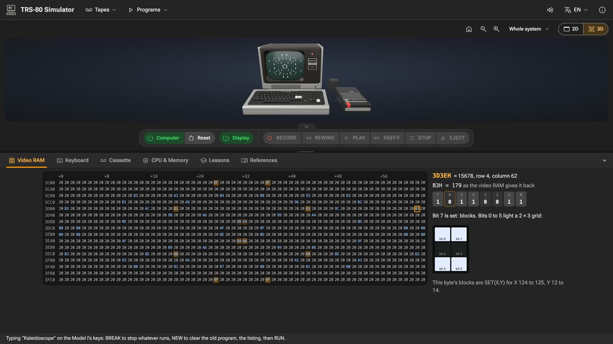
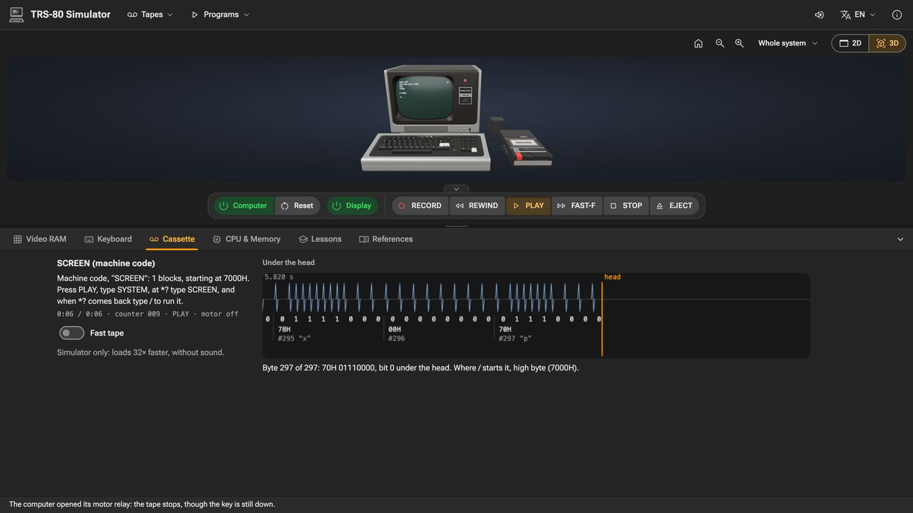
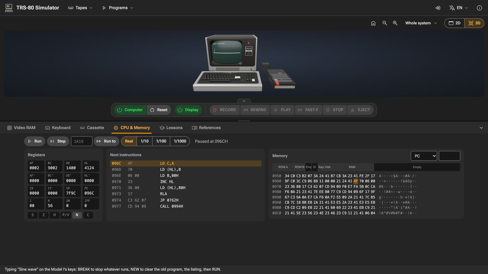

<p align="center"></p>

# TRS-80 Simulator

[](https://github.com/wixette/trs-80-simulator/actions/workflows/test.yml)

The **TRS-80 Model I** (1977) in 3D in your browser: switch it on, type Level II BASIC, load tapes, open it up, and watch the screen and keyboard work as memory. It is the Tandy Radio Shack machine of 1977, not the later Color Computer.

**[▶ Try it online](https://wixette.github.io/trs-80-simulator/)**: nothing to install, on a desktop or a phone, in ten languages.

> **v0.0.3 is a pre-release.** Everything below works, and the six lessons are complete. The layout may still change before 1.0.0 ([design/roadmap.md](design/roadmap.md)).


## What you can do

<table>
<tr>
<td colspan="2"><b>Run programs of our own</b><br>21 of them, typed in for you on the Model I's keys or loaded from tape: games, utilities and music in the style of 1977–80, and short ones to learn from.<br></td>
</tr>
<tr>
<td width="50%"><b>Switch to 2D</b><br>The machine's own faces, flat: the screen, the recorder, the keyboard. On a phone, this is where you type.<br></td>
<td width="50%"><b>Look inside while it runs</b><br>The case turns to glass; the board's chips light up as they work.<br></td>
</tr>
<tr>
<td><b>Take it apart</b><br>With the power off, in the order the real one comes apart.<br></td>
<td><b>See the screen as memory</b><br>1,024 bytes, live; pick one to see its bits become dots.<br></td>
</tr>
<tr>
<td><b>Save and load programs on tape</b><br>The tape under the head, as pulses, bits and bytes.<br></td>
<td><b>Watch the CPU work</b><br>Registers, the next instructions and memory, a step at a time.<br></td>
</tr>
</table>

- **Use Level II BASIC,** Microsoft's 12 KB BASIC, on an emulated Z80 at the Model I's 1.77 MHz. Type on your own keyboard (Esc is BREAK, Enter is ENTER); held keys work, so games play.
- **Programs:** 21 of ours, in the style of 1977–80, to learn from and for fun: games (a moon lander, a worm, bricks, meteors, a text adventure), utilities (a clock, a calendar, a biorhythm chart, a banner) and music. Each is typed in for you on the Model I's keys, or loaded from its tape. **Find original programs** says where the era's own software is archived and how to load it; open your own `.cas` or `.wav` files, or a listing to type in, and save any tape as either.
- **Sound,** as owners had it: the cassette lead into an amplifier.
- **Ten languages:** English, Español, Français, Deutsch, Italiano, Português (Brasil), 简体中文, 繁體中文, 日本語 and 한국어, the lessons included. The machine's own words (BREAK, `READY`, BASIC) stay as the machine has them.
- **Six lessons** for a middle-school class or a first course in computer science, below.

## The lessons

Every step can be typed for you, and ticks itself when the machine shows it done.

1. **Meet the TRS-80:** a computer you could buy in a shop in 1977, and its parts.
2. **Talk to BASIC:** `PRINT`, a first program, a loop, `INPUT`.
3. **The screen is memory:** a letter is a byte; draw with `SET`, then find the picture in memory.
4. **The keyboard is memory:** keys are switches in rows, read as bytes.
5. **Programs as sound:** save a program to tape, see its bits, load it back; data on tape, and music.
6. **Inside the CPU:** machine code put in with `POKE`, then stepped through one instruction at a time.

Teacher notes, with timings and the questions students ask, in English: [lessons/teacher-notes.md](lessons/teacher-notes.md).

## Try it in a minute

1. Open the simulator. The machine is already on, asking `MEMORY SIZE?`.
2. Press Enter, for all the memory.
3. Type `PRINT "HELLO"` and press Enter.
4. Open **Programs**, choose one, and **Type it in**.

## Run it locally

There is nothing to build. Serve the folder over HTTP:

```
git clone https://github.com/wixette/trs-80-simulator.git
cd trs-80-simulator
python3 -m http.server 8000
```

Then open <http://localhost:8000/>.

## For developers

How the simulator is checked, built and released is in [docs/development.md](docs/development.md):
- the rules the code follows: [docs/conventions.md](docs/conventions.md);
- the page's design: [docs/ui-design.md](docs/ui-design.md);
- the machine's decisions: [design/decisions.md](design/decisions.md);
- the 3D model: [model/README.md](model/README.md).

The machine's sources are in [research/](research/).

## Licences

- The simulator's code is under the [Apache License 2.0](LICENSE).
- The 3D model, the lessons, the docs and the research notes are under [CC BY-SA 4.0](LICENSES/CC-BY-SA-4.0.txt).
- **Level II BASIC** in `roms/` is not ours: its copyright is Microsoft's and Tandy's. It is carried as a historical artifact, as other open emulators carry it. [roms/NOTICE](roms/NOTICE) says where it came from, and offers to remove it on request.
- Third-party material keeps its own licence: the Z80 core (MIT), xtrs's character set, three.js (MIT), the fonts (OFL 1.1), the icons (Apache-2.0) and the photographs. Each is listed in [docs/licensing.md](docs/licensing.md) and declared per file in `REUSE.toml`.

"TRS-80" names the machine simulated. This project is not affiliated with Tandy Corporation or RadioShack.

## Credits

- **RetroStack**'s reconstructions of the Model I: the boards, the case and *The TRS-80 Model I, as established*, a netlist-checked reference that the machine and the model are built from.
- **Lawrence Kesteloot**'s TRS-80 emulator, the reference for reading real tapes, and the second source for the ROM.
- **Matthew Reed**'s [TRS-80.org](https://www.trs-80.org/), for the history.
- **Molly Howell**'s `Z80.js`.
- **Tim Mann**'s xtrs, for the character set.
- The photographers credited in [images/photos/CREDITS.md](images/photos/CREDITS.md).
